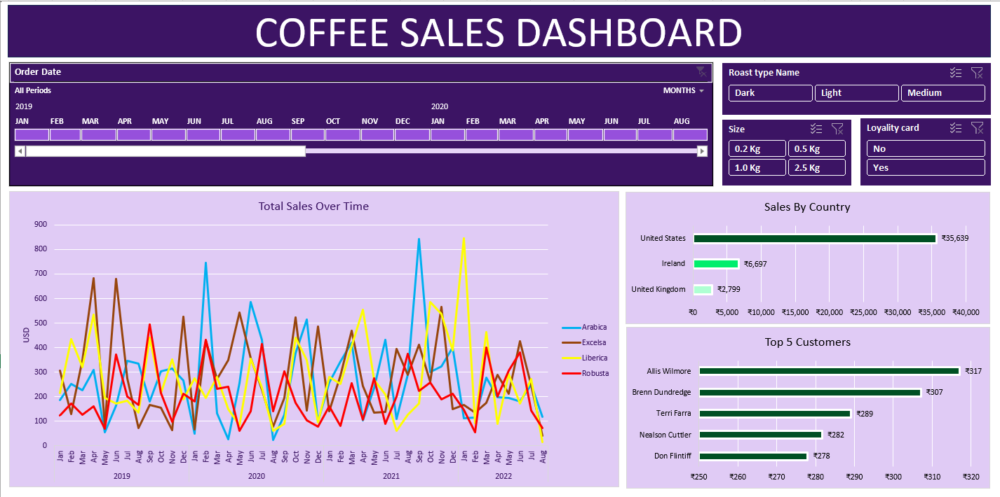

# ☕ Coffee Sales Performance Dashboard (Excel)

An end-to-end interactive Excel dashboard developed to analyze coffee sales performance, customer purchasing behaviors, and regional revenue patterns across a multi-year timeframe.

---

## 📸 Dashboard Preview

---

## 📌 Project Overview

This project highlights core data analytics capabilities using Microsoft Excel, covering data cleaning, multi-table data modeling using formulas, dynamic aggregation with Pivot Tables, and user-centric dashboard UI design.

---

## 📊 Key Business Questions Solved

* **Sales Trends:** How do coffee revenues and order volumes fluctuate across different months and years?
* **Product Performance:** Which coffee roast types (Espresso, Latte, Cappuccino, Dark Roast) generate maximum revenue?
* **Customer Insights:** Who are the top purchasing customers, and what are their buying preferences?
* **Geographic Revenue:** Which countries (United States, Ireland, United Kingdom) drive the maximum sales volume?

---

## 🛠️ Excel Tools & Techniques Used

* **Data Cleaning & Formatting:** Standardized dates, handled missing data, removed duplicate records, and configured custom currency/number formats.
* **Advanced Formulas:**
  * `XLOOKUP` & `INDEX/MATCH` for dynamic data fetching across customer and product sheets.
  * Nested `IF` statements to handle unit pricing logic and order size classifications.
* **Pivot Tables & Visualizations:** Aggregated metrics into interactive line charts, horizontal bar charts, and top customer tables.
* **Interactive Controls:** Integrated interactive **Slicers** (Roast Type, Size, Loyalty Card) and **Timelines** (Order Date) connected across all charts.

---

## 💡 Key Business Insights

1. **Top Country Revenue:** The United States generates the vast majority of overall sales volume compared to Ireland and the UK.
2. **Customer Loyalty Impact:** A core group of top repeat customers accounts for a high share of total revenue.
3. **Seasonal Demand Surges:** Monthly sales trends highlight clear peak periods ideal for targeted marketing campaigns.

---

## 🚀 How to Explore This Project

1. Download the Excel workbook (`COFFEE SALES DASHBOARD PROJECT.xlsx`) from this repository.
2. Open the file in **Microsoft Excel**.
3. Use the **Slicers** and **Timelines** on the Dashboard sheet to filter and analyze the data dynamically.
